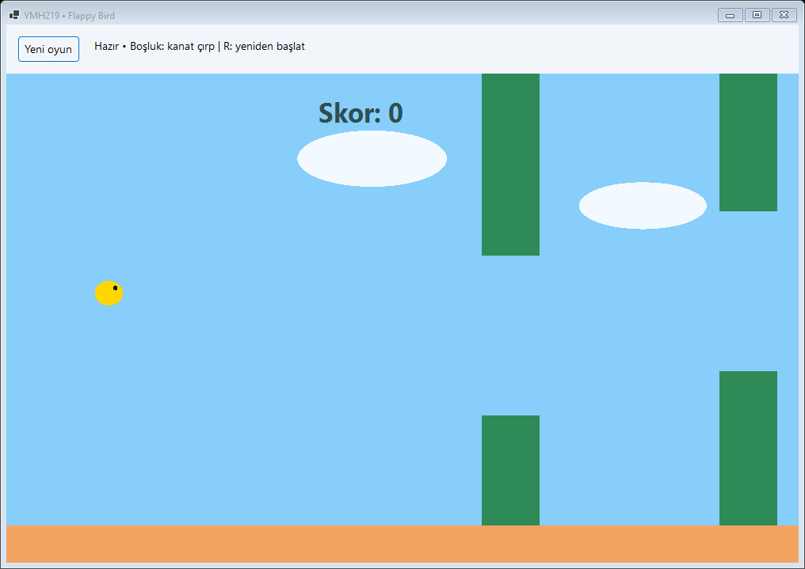
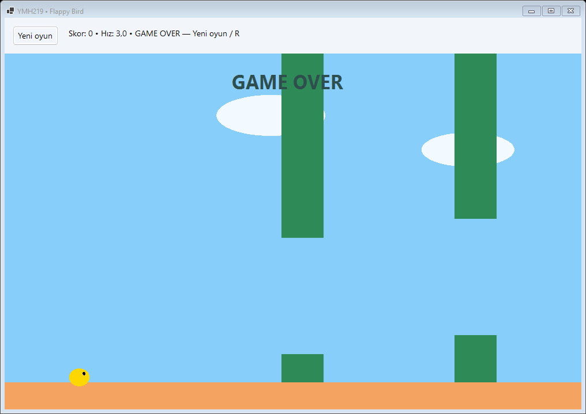

# Flappy Bird

YMH219 Nesne Tabanlı Programlama ek uygulama ödevi. C# ile geliştirilen Windows Forms masaüstü uygulaması.

## Teknolojiler
Windows x64, C#, .NET 10, Windows Forms. Ek NuGet paketi yok.

## Kurulum ve çalıştırma
1. .NET 10 SDK ve .NET 10 destekli Visual Studio (.NET masaüstü geliştirme iş yükü) kurun.
2. `FlappyBird.sln` dosyasını açın, NuGet paketlerini geri yükleyin ve F5 ile çalıştırın.
3. Alternatif: bu klasörde `dotnet run --project FlappyBird.csproj` çalıştırın.
4. Derleme kontrolü: `dotnet build FlappyBird.csproj -c Release`.

## Temel özellikler ve kullanım
Boşluk ile kuşu yükseltin; R veya Yeni oyun ile yeniden başlayın. Üç engel çifti, yer çekimi, çarpışma, skor ve skora bağlı hız artışı bulunur.

## Ekran görüntüleri

## Sınırlamalar ve geliştirme notları
Kuş, engel ve oyun durumu Bird, Pipe ve Game sınıflarında tutulur. Skor oturum boyunca saklanır; kalıcı rekor yoktur.

Arayüz MainForm, başlangıç Program, ortak görsel yardımcılar Ui sınıfındadır. Formların Dispose metotları kullanılan kaynakları temizler.

## Öğrenci bilgileri
- Ad soyad: **Talha Nuri Önder**
- Öğrenci numarası: **210541054**

## GitHub teslimi
Bu klasörü `YMH219-FlappyBird` adlı ayrı bir **public** depoya yükleyin. `bin`, `obj`, `.vs` ve yerel kişisel veri klasörleri .gitignore kapsamındadır. Öğrenci bilgilerini tamamlayın. Kendi yaptığınız değişiklikleri anlamlı commitlerle kaydedin; geçmiş tarihe ait geliştirme geçmişi üretilmemiştir. Classroom'a GitHub profil bağlantınızı teslim edin. Son tarih: **30 Kasım 2026 23:59**.
